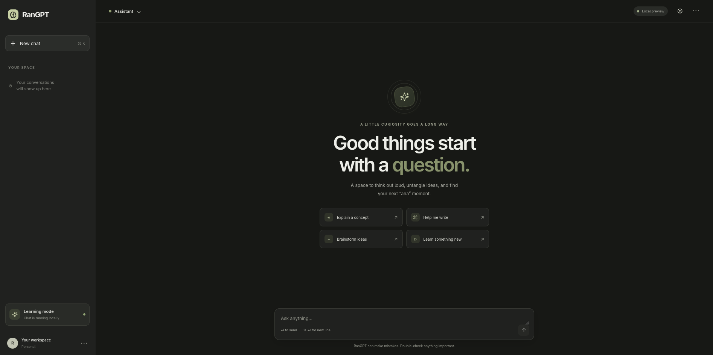

# RanGPT

RanGPT is a small streaming chat application built as a learning project for integrating a language model into a web app. It uses a React and TypeScript frontend and a Node.js API, organized as a pnpm and Turborepo monorepo.

## Preview

[](assets/rangpt.mp4)

[▶ Watch the RanGPT demo video](assets/rangpt.mp4)

## How it works

1. The browser sends a message to the API's `POST /chat` endpoint.
2. The Fastify API validates the message and requests a streamed response from OpenAI's Responses API using `gpt-6-luna`.
3. The API forwards text as newline-delimited JSON (NDJSON) events. The frontend reads each event and updates the assistant message as chunks arrive.
4. The API key stays on the server. The browser only knows the API URL.

The chat currently keeps messages in the page's memory; it does not save conversation history. The light or dark appearance preference is saved in browser local storage.

## Project structure

```text
apps/
  api/    Fastify API, OpenAI integration, and request validation
  web/    React, TypeScript, Vite, and Tailwind CSS frontend
```

## Requirements

- Node.js 20 or newer
- pnpm 10 (the repository pins pnpm 10.18.3)
- An OpenAI API key with access to the configured model

## Run locally

Install dependencies from the repository root:

```bash
pnpm install
```

Create environment files from the examples:

```bash
cp apps/api/.env.example apps/api/.env
cp apps/web/.env.example apps/web/.env
```

Set `OPENAI_API_KEY` in `apps/api/.env`. The API listens on `http://127.0.0.1:5000` by default. `WEB_ORIGINS` is a comma-separated allowlist; keep it aligned with the frontend's local origin (`http://127.0.0.1:5173` or `http://localhost:5173`). `VITE_API_URL` in `apps/web/.env` should point to the API origin. Environment files are ignored by Git; do not put the API key in a `VITE_` variable.

Start both apps in development mode:

```bash
pnpm dev
```

Then open `http://127.0.0.1:5173`. You can also run either app on its own with `pnpm --filter api dev` or `pnpm dev:web`. The API health endpoint is `GET /health`.

## Streaming response format

`POST /chat` accepts a JSON body such as `{"message":"Why is the sky blue?"}`. Its response is NDJSON, with one JSON event per line:

```json
{"type":"delta","text":"Because..."}
{"type":"delta","text":"the atmosphere..."}
{"type":"done"}
```

A stream error is returned as an `error` event. To inspect the stream from a terminal, run:

```bash
curl -N http://127.0.0.1:5000/chat \
  -H 'Content-Type: application/json' \
  -d '{"message":"Say hello in one sentence."}'
```

## Workspace commands

Run these from the repository root:

```bash
pnpm dev           # Run the frontend and API
pnpm build         # Build both apps
pnpm check-types   # Type-check both apps
pnpm lint          # Check formatting and lint rules with Biome
pnpm format        # Apply Biome formatting and safe fixes
```

Husky runs `pnpm lint` before each commit. The code is intentionally small and is meant to be extended while learning API design, validation, streaming, error handling, and server-side secret management.

## License

This project is licensed under the [MIT License](LICENSE).
